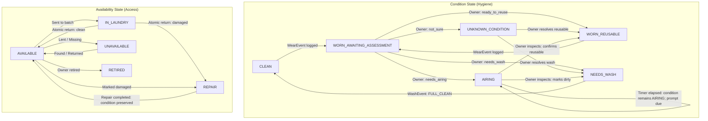

# Vougenze — Version 0 Frozen Specification & Implementation Contract

> [!IMPORTANT]
> **Status: FROZEN FOR V0 IMPLEMENTATION**  
> **Frozen by: Owner**  
> **Frozen at: 2026-10-24T04:47:00Z**  
> **Specification revision: 2.2.1-final.1**  
> **Specification SHA-256: CE715D37CAB49FAE68FEBDF549CAFF149794DDB958F59C187470943542F643AD**  
>
> **Authorized implementation scope:**
> - SQLite schema and migrations
> - Repository and transaction boundaries
> - State-transition engine
> - 42 acceptance scenarios
> - Headless wardrobe simulator
> - V0 deterministic scorers
> - Bounded continuation planner
>
> **Not authorized:**
> - Preference-model training
> - Unsupported Google AI simulation results
> - ONNX deployment
> - Cloud inference integration
> - Body analysis
> - Shopping recommendations
> - Expansion of V0 scope

---

## Part 1: Architectural Principles & Governing Decisions

### 1.1 Hierarchy of Authority
1. **Explicit Owner Decision:** Manual selection, condition override, veto, retirement, duplicate resolution, wear authorization.
2. **Confirmed Physical Event:** Logged wear, confirmed laundry drop-off/receipt, confirmed wash.
3. **Owner-Verified Metadata:** User-corrected attributes, tags, custom wear limits.
4. **Learned Personal Pattern:** Statistically observed reuse intervals and verified feedback.
5. **Imported AI Analysis:** Structured output from external multimodal models.
6. **General Fashion Prior:** Pretrained compatibility heuristics and standard color harmony.
7. **Fallback Assumption:** Default starting priors and conservative hygiene baselines.

### 1.2 Two Orthogonal State Dimensions
Physical condition (hygiene/cleanliness) and physical availability (accessibility) are strictly decoupled:
* **Condition Dimension:** `CLEAN`, `WORN_AWAITING_ASSESSMENT`, `UNKNOWN_CONDITION`, `WORN_REUSABLE`, `AIRING`, `NEEDS_WASH`.  
  *(A garment in airing remains in condition `AIRING` until the owner assesses it; an `airing_review_due_at` timestamp triggers the prompt when due. `READY_FOR_REVIEW` is not an operational physical state).*
* **Availability Dimension:** `AVAILABLE`, `IN_LAUNDRY`, `UNAVAILABLE`, `REPAIR`, `RETIRED`.

**Core Invariant:** Changes in availability preserve condition state. (e.g. A garment in `REPAIR` with condition `NEEDS_WASH` remains `NEEDS_WASH` when returned to `AVAILABLE` unless an atomic `WashEvent` occurs).

### 1.3 Local Time & Timestamps Policy
* **Instant Timestamps:** All event logs and record creation timestamps (`created_at`, `occurred_at`, `worn_at`, `confirmed_clean_at`, `airing_review_due_at`, `authorized_at`) are stored as ISO 8601 strings in **UTC** (`YYYY-MM-DDTHH:MM:SSZ`).
* **User Timezone:** `User.timezone_id` stores an authoritative IANA timezone identifier (e.g. `'Asia/Kolkata'`, `'America/New_York'`).
* **Local Civil Time:** Session dates (`session_date` formatted `YYYY-MM-DD`), wear history local dates (`local_wear_date`), and laundry weekdays operate on local civil dates derived via the user's `timezone_id`, preventing UTC-boundary shifts.

### 1.4 Historical Retention & The 100-Day Active Window
* **Indefinite Retention:** Complete wear history is retained indefinitely unless explicitly voided or corrected by the owner. Older history supports long-term utilization queries, taste drift analysis, and condition tracking.
* **Configurable Active Planning Window:** By default, the planner evaluates the most recent **100 local calendar days** for repetition penalties, rotation balance, and recent preference evidence.
  * Available settings: `30`, `60`, `100`, `180`, `365`, or `-1` (All history).
  * Window boundaries are evaluated using local civil dates (`local_wear_date`).
* **Recency Bands (V0 Baseline Heuristic):**
  * **0–1 days (Very recent):** High repetition penalty; consecutive-wear rules enforced.
  * **2–3 days (Recent):** Moderate repetition penalty for visible items.
  * **4–7 days (Moderately recent):** Low repetition penalty.
  * **8–14 days (Light relevance):** Minimal repetition concern.
  * **15–30 days (Negligible repeat concern):** No direct repetition penalty for most items.
  * **31–100 days (Historical utilization & preference):** Used for usage frequency, rotation balance, and positive/negative preference evidence; no direct repetition penalty.
* **Storage Economics & Measurement:** Structured wear history is expected to remain small relative to images and model files. The implementation must measure database size after representative fixtures rather than assume a fixed upper bound. Photographs are referenced by URI and never duplicated into historical wear logs.

---

## Part 2: Normalized SQLite Schema

Every SQLite connection must explicitly verify:
```sql
PRAGMA foreign_keys = ON;
```

### 2.1 Physical Categories, Contexts & Layering
* **Physical Categories:** `top`, `bottom`, `one_piece`, `footwear`, `outerwear`, `accessory`, `bag`, `headwear`, `jewellery`
* **Usage Contexts:** `university`, `office`, `party`, `casual`, `home_casual`, `sleepwear`, `traditional`, `cultural`, `exercise`, `travel`, `presentation`, `formal`
* **Layering Roles (Inners Excluded):** `base`, `mid`, `outer`, `standalone`

---

### 2.2 User

```sql
CREATE TABLE User (
    id                      TEXT PRIMARY KEY,
    display_name            TEXT NOT NULL,
    climate_zone            TEXT,
    timezone_id             TEXT NOT NULL DEFAULT 'UTC', -- IANA identifier, e.g. 'Asia/Kolkata'
    active_history_window   INTEGER NOT NULL DEFAULT 100 CHECK (active_history_window IN (30, 60, 100, 180, 365, -1)), -- -1 = ALL
    created_at              TEXT NOT NULL DEFAULT (strftime('%Y-%m-%dT%H:%M:%SZ','now'))
);
```

---

### 2.3 Garment Intake & Duplicate Detection Staging

Incoming photographs and duplicate detection are staged **before** creating a catalogued garment.

```sql
CREATE TABLE GarmentIntakeDraft (
    id                      TEXT PRIMARY KEY,
    user_id                 TEXT NOT NULL REFERENCES User(id),
    temporary_image_path    TEXT NOT NULL,
    status                  TEXT NOT NULL DEFAULT 'PENDING' CHECK (
        status IN ('PENDING', 'ATTACHED_TO_EXISTING', 'CREATED_NEW_GARMENT', 'CANCELLED')
    ),
    created_at              TEXT NOT NULL DEFAULT (strftime('%Y-%m-%dT%H:%M:%SZ','now'))
);

CREATE TABLE GarmentIntakeFingerprint (
    id                  TEXT PRIMARY KEY,
    intake_draft_id     TEXT NOT NULL REFERENCES GarmentIntakeDraft(id) ON DELETE CASCADE,
    sha256              TEXT NOT NULL,
    perceptual_hash     TEXT,
    embedding_model     TEXT,
    embedding_vector    BLOB,
    created_at          TEXT NOT NULL DEFAULT (strftime('%Y-%m-%dT%H:%M:%SZ','now'))
);

CREATE TABLE GarmentDuplicateCandidate (
    id                      TEXT PRIMARY KEY,
    user_id                 TEXT NOT NULL REFERENCES User(id),
    intake_draft_id         TEXT NOT NULL REFERENCES GarmentIntakeDraft(id) ON DELETE CASCADE,
    existing_garment_id     TEXT NOT NULL REFERENCES Garment(id),
    exact_hash_match        INTEGER NOT NULL DEFAULT 0,
    perceptual_distance     INTEGER,
    visual_similarity       REAL,
    metadata_similarity     REAL,
    detector_version        TEXT NOT NULL,
    status                  TEXT NOT NULL DEFAULT 'PENDING' CHECK (
        status IN ('PENDING', 'SAME_GARMENT', 'DIFFERENT_GARMENT', 'LINKED_SIMILAR', 'DISMISSED')
    ),
    resolution_note         TEXT,
    resolved_at             TEXT
);
```

---

### 2.4 Garment & Catalogued Images

```sql
CREATE TABLE Garment (
    id                  TEXT PRIMARY KEY,
    user_id             TEXT NOT NULL REFERENCES User(id),
    name                TEXT NOT NULL,

    -- Physical Classification
    physical_category   TEXT NOT NULL,      -- top, bottom, one_piece, footwear, outerwear, accessory, bag, headwear, jewellery
    subcategory         TEXT NOT NULL,      -- e.g. kurta, chino, sneaker, oversized_shirt
    cut_and_fit         TEXT NOT NULL,      -- boxy, slim, regular, relaxed, oversized, tapered
    fills_roles         TEXT NOT NULL DEFAULT '[]', -- JSON: ["top","bottom"] for one_piece; ["top"] for shirts

    -- Aesthetics
    primary_color       TEXT NOT NULL,
    secondary_colors    TEXT DEFAULT '[]',
    pattern_type        TEXT DEFAULT 'solid',
    formality           INTEGER NOT NULL DEFAULT 2 CHECK (formality BETWEEN 1 AND 5),
    style_tags          TEXT NOT NULL DEFAULT '[]',
    layering_role       TEXT,              -- base, mid, outer, standalone (NO inners)

    -- Usage & Cultural Context
    usage_contexts      TEXT NOT NULL DEFAULT '[]',  -- JSON: ["university","sleepwear","traditional"]
    cultural_context    TEXT,              -- "western", "traditional", "fusion", null
    weather_suitability TEXT NOT NULL DEFAULT '[]',

    -- Reuse Policy
    research_review_after_wears     INTEGER NOT NULL DEFAULT 1 CHECK (research_review_after_wears >= 1),
    owner_review_after_wears        INTEGER CHECK (owner_review_after_wears IS NULL OR owner_review_after_wears >= 1),
    hard_limit_wears                INTEGER CHECK (hard_limit_wears IS NULL OR hard_limit_wears >= 1),
    consecutive_wear_tolerance      TEXT NOT NULL DEFAULT 'avoid',
    context_wear_adjustments        TEXT DEFAULT '{}',
    usually_worn_over_inner_layer   INTEGER NOT NULL DEFAULT 0,
    expected_airing_hours           REAL DEFAULT 8.0 CHECK (expected_airing_hours >= 0),
    airing_review_due_at            TEXT, -- UTC timestamp when airing inspection becomes due

    -- Personal Desirability
    like_rating         INTEGER DEFAULT 5 CHECK (like_rating BETWEEN 1 AND 10),
    priority_level      TEXT NOT NULL DEFAULT 'NORMAL' CHECK (priority_level IN ('FAVOURITE','NORMAL','FALLBACK_ONLY','DO_NOT_RECOMMEND')),
    context_priority_overrides TEXT DEFAULT '{}',

    -- Condition State (Hygiene dimension - NO READY_FOR_REVIEW)
    condition_state     TEXT NOT NULL DEFAULT 'CLEAN' CHECK (
        condition_state IN ('CLEAN', 'WORN_AWAITING_ASSESSMENT', 'UNKNOWN_CONDITION', 'WORN_REUSABLE', 'AIRING', 'NEEDS_WASH')
    ),

    -- Availability State (Physical access dimension)
    availability_state  TEXT NOT NULL DEFAULT 'AVAILABLE' CHECK (
        availability_state IN ('AVAILABLE', 'IN_LAUNDRY', 'UNAVAILABLE', 'REPAIR', 'RETIRED')
    ),
    unavailability_reason TEXT,

    -- Wear & Laundry Tracking
    wears_since_confirmed_wash INTEGER NOT NULL DEFAULT 0 CHECK (wears_since_confirmed_wash >= 0),
    last_worn_at            TEXT,
    last_confirmed_wash_at  TEXT,
    current_laundry_batch_id TEXT REFERENCES LaundryBatch(id),

    -- Condition Assessment Link
    current_condition_assessment_id TEXT REFERENCES GarmentCondition(id),

    -- Provenance
    owner_verified      INTEGER NOT NULL DEFAULT 0,
    created_at          TEXT NOT NULL DEFAULT (strftime('%Y-%m-%dT%H:%M:%SZ','now')),
    updated_at          TEXT NOT NULL DEFAULT (strftime('%Y-%m-%dT%H:%M:%SZ','now'))
);

CREATE TABLE GarmentImage (
    id          TEXT PRIMARY KEY,
    garment_id  TEXT NOT NULL REFERENCES Garment(id) ON DELETE CASCADE,
    image_path  TEXT NOT NULL,
    image_type  TEXT NOT NULL DEFAULT 'full',  -- full, detail, care_label, damage
    is_primary  INTEGER NOT NULL DEFAULT 0,
    created_at  TEXT NOT NULL DEFAULT (strftime('%Y-%m-%dT%H:%M:%SZ','now'))
);

CREATE TABLE GarmentImageFingerprint (
    id                  TEXT PRIMARY KEY,
    garment_image_id    TEXT NOT NULL REFERENCES GarmentImage(id) ON DELETE CASCADE,
    sha256              TEXT NOT NULL,
    perceptual_hash     TEXT,
    embedding_model     TEXT,
    embedding_vector    BLOB,
    created_at          TEXT NOT NULL DEFAULT (strftime('%Y-%m-%dT%H:%M:%SZ','now'))
);
```

---

### 2.5 GarmentWearAuthorization (CORRECTED: Auditable Override)

Replaces untracked wear counters with auditable, consumable authorization records.

```sql
CREATE TABLE GarmentWearAuthorization (
    id                  TEXT PRIMARY KEY,
    garment_id          TEXT NOT NULL REFERENCES Garment(id) ON DELETE CASCADE,
    authorized_by       TEXT NOT NULL DEFAULT 'owner',
    reason              TEXT,
    authorized_at       TEXT NOT NULL DEFAULT (strftime('%Y-%m-%dT%H:%M:%SZ','now')),
    consumed_by_wear_event_id TEXT REFERENCES WearEvent(id),
    status              TEXT NOT NULL DEFAULT 'AVAILABLE' CHECK (
        status IN ('AVAILABLE', 'CONSUMED', 'CANCELLED')
    )
);
```

---

### 2.6 GarmentAnalysisImport, Condition & State Transitions

```sql
CREATE TABLE GarmentAnalysisImport (
    id                  TEXT PRIMARY KEY,
    garment_id          TEXT NOT NULL REFERENCES Garment(id) ON DELETE CASCADE,
    provider            TEXT NOT NULL,
    model_version       TEXT,
    prompt_version      TEXT,
    raw_json            TEXT NOT NULL,
    imported_at         TEXT NOT NULL DEFAULT (strftime('%Y-%m-%dT%H:%M:%SZ','now')),
    owner_accepted      INTEGER NOT NULL DEFAULT 0,
    owner_corrections   TEXT DEFAULT '{}'
);

CREATE TABLE GarmentCondition (
    id              TEXT PRIMARY KEY,
    garment_id      TEXT NOT NULL REFERENCES Garment(id) ON DELETE CASCADE,
    assessed_at     TEXT NOT NULL DEFAULT (strftime('%Y-%m-%dT%H:%M:%SZ','now')),
    condition_grade TEXT NOT NULL,       -- EXCELLENT, GOOD, WORN_SERVICEABLE, POOR, NEEDS_REPAIR
    issues          TEXT DEFAULT '[]',
    assessed_by     TEXT NOT NULL DEFAULT 'owner',
    notes           TEXT
);

CREATE TABLE GarmentStateTransition (
    id              TEXT PRIMARY KEY,
    garment_id      TEXT NOT NULL REFERENCES Garment(id) ON DELETE CASCADE,
    state_dimension TEXT NOT NULL CHECK (state_dimension IN ('condition', 'availability')),
    from_state      TEXT NOT NULL,
    to_state        TEXT NOT NULL,
    trigger_event   TEXT NOT NULL,
    trigger_details TEXT DEFAULT '{}',
    occurred_at     TEXT NOT NULL DEFAULT (strftime('%Y-%m-%dT%H:%M:%SZ','now'))
);
```

---

### 2.7 WearSession, Templates & Routines

```sql
CREATE TABLE WearSession (
    id                      TEXT PRIMARY KEY,
    user_id                 TEXT NOT NULL REFERENCES User(id),
    session_date            TEXT NOT NULL, -- Local civil date: YYYY-MM-DD
    session_type            TEXT NOT NULL,
    importance              TEXT NOT NULL DEFAULT 'NORMAL' CHECK (importance IN ('LOW', 'NORMAL', 'HIGH')),
    required_roles          TEXT NOT NULL DEFAULT '["top","bottom","footwear"]',
    weather_context         TEXT,
    start_time              TEXT,          -- Local civil time: HH:MM
    expected_duration_hours REAL,
    generated_from_template_id TEXT REFERENCES WearSessionTemplate(id),
    status                  TEXT NOT NULL DEFAULT 'PLANNED' CHECK (status IN ('PLANNED', 'COMPLETED', 'CANCELLED')),
    created_at              TEXT NOT NULL DEFAULT (strftime('%Y-%m-%dT%H:%M:%SZ','now'))
);

CREATE TABLE WearSessionTemplate (
    id              TEXT PRIMARY KEY,
    user_id         TEXT NOT NULL REFERENCES User(id),
    template_name   TEXT NOT NULL,
    effective_from  TEXT NOT NULL,
    effective_until TEXT,
    created_at      TEXT NOT NULL DEFAULT (strftime('%Y-%m-%dT%H:%M:%SZ','now'))
);

CREATE TABLE WearSessionTemplateDay (
    id              TEXT PRIMARY KEY,
    template_id     TEXT NOT NULL REFERENCES WearSessionTemplate(id) ON DELETE CASCADE,
    day_of_week     INTEGER NOT NULL CHECK (day_of_week BETWEEN 0 AND 6),
    session_type    TEXT NOT NULL,
    importance      TEXT NOT NULL DEFAULT 'NORMAL' CHECK (importance IN ('LOW', 'NORMAL', 'HIGH')),
    required_roles  TEXT NOT NULL DEFAULT '["top","bottom","footwear"]',
    start_time      TEXT,
    expected_duration_hours REAL,
    sort_order      INTEGER NOT NULL DEFAULT 0
);
```

---

### 2.8 OutfitWearLog, Snapshots & Safe Correction Semantics (CORRECTED)

Uniqueness of active session outfits is enforced via a partial unique index (`idx_one_active_wear_log_per_session`), allowing replacement records for corrections without conflict.

```sql
CREATE TABLE OutfitWearLog (
    id                          TEXT PRIMARY KEY,
    user_id                     TEXT NOT NULL REFERENCES User(id),
    session_id                  TEXT NOT NULL REFERENCES WearSession(id),
    recommendation_plan_id      TEXT REFERENCES RecommendationPlan(id),
    plan_assignment_id          TEXT REFERENCES PlanSessionAssignment(id),

    source                      TEXT NOT NULL CHECK (
        source IN ('recommended_selected', 'manual_outfit', 'saved_outfit', 'modified_recommendation')
    ),

    started_at_utc              TEXT,
    ended_at_utc                TEXT,
    local_wear_date             TEXT NOT NULL, -- YYYY-MM-DD in user's timezone
    timezone_id                 TEXT NOT NULL,

    occasion_profile_id         TEXT REFERENCES OccasionProfile(id),
    session_type                TEXT NOT NULL,
    importance                  TEXT NOT NULL DEFAULT 'NORMAL' CHECK (importance IN ('LOW', 'NORMAL', 'HIGH')),

    was_recommended             INTEGER NOT NULL DEFAULT 0 CHECK (was_recommended IN (0, 1)),
    was_modified_before_wear    INTEGER NOT NULL DEFAULT 0 CHECK (was_modified_before_wear IN (0, 1)),
    modification_reason         TEXT,

    satisfaction_rating         INTEGER CHECK (satisfaction_rating IS NULL OR satisfaction_rating BETWEEN 1 AND 10),
    comfort_rating              INTEGER CHECK (comfort_rating IS NULL OR comfort_rating BETWEEN 1 AND 10),
    occasion_fit_rating         INTEGER CHECK (occasion_fit_rating IS NULL OR occasion_fit_rating BETWEEN 1 AND 10),
    would_wear_again            INTEGER CHECK (would_wear_again IS NULL OR would_wear_again IN (0, 1)),

    -- Safe Correction / Voiding
    record_status               TEXT NOT NULL DEFAULT 'ACTIVE' CHECK (record_status IN ('ACTIVE', 'CORRECTED', 'VOIDED')),
    correction_reason           TEXT,
    superseded_by_id            TEXT REFERENCES OutfitWearLog(id),

    feedback_notes              TEXT,
    created_at                  TEXT NOT NULL DEFAULT (strftime('%Y-%m-%dT%H:%M:%SZ','now'))
);

CREATE TABLE OutfitWearLogItem (
    outfit_wear_log_id  TEXT NOT NULL REFERENCES OutfitWearLog(id),
    garment_id          TEXT NOT NULL REFERENCES Garment(id),
    outfit_role         TEXT NOT NULL,

    condition_at_wear   TEXT NOT NULL,
    availability_at_wear TEXT NOT NULL,
    wears_before_event  INTEGER NOT NULL,

    garment_snapshot    TEXT NOT NULL DEFAULT '{}',
    -- Compact point-in-time snapshot of garment attributes
    PRIMARY KEY (outfit_wear_log_id, garment_id, outfit_role)
);
```

---

### 2.9 WearEvent & PostWearAssessment (CORRECTED)

Uniqueness of active wear events is enforced via a partial unique index (`idx_one_active_wear_event_per_session_garment`), permitting voided events to be superseded transactionally.

```sql
CREATE TABLE WearEvent (
    id                  TEXT PRIMARY KEY,
    session_id          TEXT NOT NULL REFERENCES WearSession(id),
    garment_id          TEXT NOT NULL REFERENCES Garment(id),
    outfit_wear_log_id  TEXT REFERENCES OutfitWearLog(id),
    worn_at             TEXT NOT NULL DEFAULT (strftime('%Y-%m-%dT%H:%M:%SZ','now')),
    duration_hours      REAL,
    activity_level      TEXT DEFAULT 'moderate',
    is_voided           INTEGER NOT NULL DEFAULT 0 CHECK (is_voided IN (0, 1))
);

CREATE TABLE PostWearAssessment (
    id              TEXT PRIMARY KEY,
    wear_event_id   TEXT NOT NULL REFERENCES WearEvent(id),
    garment_id      TEXT NOT NULL REFERENCES Garment(id),
    assessment      TEXT NOT NULL CHECK (
        assessment IN ('ready_to_reuse', 'needs_airing', 'needs_wash', 'stained', 'wet', 'not_sure')
    ),
    assessed_at     TEXT NOT NULL DEFAULT (strftime('%Y-%m-%dT%H:%M:%SZ','now')),
    notes           TEXT,
    UNIQUE(wear_event_id)
);
```

---

### 2.10 WashEvent

```sql
CREATE TABLE WashEvent (
    id                  TEXT PRIMARY KEY,
    user_id             TEXT NOT NULL REFERENCES User(id),
    garment_id          TEXT NOT NULL REFERENCES Garment(id),
    laundry_batch_id    TEXT REFERENCES LaundryBatch(id),
    cleaning_scope      TEXT NOT NULL DEFAULT 'FULL_CLEAN' CHECK (cleaning_scope IN ('FULL_CLEAN', 'PARTIAL_CLEAN')),
    method              TEXT NOT NULL CHECK (
        method IN ('laundry_service', 'home_machine', 'hand_wash', 'dry_clean', 'spot_clean', 'other')
    ),
    confirmed_clean_at  TEXT NOT NULL,
    confirmed_by        TEXT NOT NULL DEFAULT 'owner',
    notes               TEXT
);
```

---

### 2.11 LaundryPolicy, Batches & Item Terminal Outcomes (CORRECTED)

Includes explicit `wash_confirmed` boolean flag to eliminate ambiguity upon damaged or partial laundry return.

```sql
CREATE TABLE LaundryPolicy (
    id                  TEXT PRIMARY KEY,
    user_id             TEXT NOT NULL REFERENCES User(id),
    policy_type         TEXT NOT NULL,
    handover_weekday    INTEGER CHECK (handover_weekday BETWEEN 0 AND 6),
    return_weekday      INTEGER CHECK (return_weekday BETWEEN 0 AND 6),
    interval_days       INTEGER,
    dirty_threshold     INTEGER,
    effective_from      TEXT NOT NULL,
    effective_until     TEXT,
    created_at          TEXT NOT NULL DEFAULT (strftime('%Y-%m-%dT%H:%M:%SZ','now'))
);

CREATE TABLE LaundryBatch (
    id                      TEXT PRIMARY KEY,
    user_id                 TEXT NOT NULL REFERENCES User(id),
    policy_id               TEXT REFERENCES LaundryPolicy(id),
    sent_date               TEXT NOT NULL,
    expected_return_date    TEXT NOT NULL,
    confirmed_return_date   TEXT,
    status                  TEXT NOT NULL DEFAULT 'IN_LAUNDRY' CHECK (
        status IN ('IN_LAUNDRY', 'RETURNED_CONFIRMED', 'PARTIAL_RETURN', 'DELAYED')
    ),
    wash_method             TEXT DEFAULT 'laundry_service',
    notes                   TEXT,
    created_at              TEXT NOT NULL DEFAULT (strftime('%Y-%m-%dT%H:%M:%SZ','now'))
);

CREATE TABLE LaundryBatchItem (
    batch_id        TEXT NOT NULL REFERENCES LaundryBatch(id) ON DELETE CASCADE,
    garment_id      TEXT NOT NULL REFERENCES Garment(id),
    item_status     TEXT NOT NULL DEFAULT 'IN_LAUNDRY' CHECK (
        item_status IN (
            'IN_LAUNDRY',
            'RETURNED_CLEAN',
            'RETURNED_DAMAGED',
            'RETURNED_UNWASHED',
            'MISSING_RESOLVED'
        )
    ),
    wash_confirmed  INTEGER NOT NULL DEFAULT 0 CHECK (wash_confirmed IN (0, 1)),
    PRIMARY KEY (batch_id, garment_id)
);
```

---

### 2.12 OccasionProfile & SavedOutfit

```sql
CREATE TABLE OccasionProfile (
    id              TEXT PRIMARY KEY,
    user_id         TEXT NOT NULL REFERENCES User(id),
    name            TEXT NOT NULL,
    formality_min   INTEGER DEFAULT 1 CHECK (formality_min BETWEEN 1 AND 5),
    formality_max   INTEGER DEFAULT 5 CHECK (formality_max BETWEEN 1 AND 5),
    required_roles  TEXT NOT NULL DEFAULT '["top","bottom","footwear"]',
    style_direction TEXT DEFAULT '[]',
    prohibited_items TEXT DEFAULT '[]',
    is_recurring    INTEGER NOT NULL DEFAULT 0,
    notes           TEXT
);

CREATE TABLE SavedOutfit (
    id              TEXT PRIMARY KEY,
    user_id         TEXT NOT NULL REFERENCES User(id),
    name            TEXT,
    occasion_tags   TEXT DEFAULT '[]',
    owner_rating    INTEGER CHECK (owner_rating BETWEEN 1 AND 10),
    times_worn      INTEGER NOT NULL DEFAULT 0,
    last_worn_at    TEXT,
    created_at      TEXT NOT NULL DEFAULT (strftime('%Y-%m-%dT%H:%M:%SZ','now'))
);

CREATE TABLE SavedOutfitItem (
    outfit_id       TEXT NOT NULL REFERENCES SavedOutfit(id) ON DELETE CASCADE,
    garment_id      TEXT NOT NULL REFERENCES Garment(id),
    outfit_role     TEXT NOT NULL,
    sort_order      INTEGER DEFAULT 0,
    PRIMARY KEY (outfit_id, garment_id, outfit_role)
);
```

---

### 2.13 Candidate Snapshots & Normalized Preference Evidence (CORRECTED)

Every compared alternative is preserved with normalized `inclusion_type` (`PRESENTED`, `FEASIBLE_NOT_PRESENTED`, `INFEASIBLE_REFERENCE`) and exclusion reasons.

```sql
CREATE TABLE OutfitCandidateSnapshot (
    id                      TEXT PRIMARY KEY,
    user_id                 TEXT NOT NULL REFERENCES User(id),
    session_id              TEXT REFERENCES WearSession(id),
    generator_version       TEXT NOT NULL,
    feature_schema_version  TEXT NOT NULL,
    compatibility_score     REAL,
    occasion_score          REAL,
    preference_score        REAL,
    repetition_penalty      REAL,
    feature_snapshot        TEXT NOT NULL DEFAULT '{}',
    created_at              TEXT NOT NULL DEFAULT (strftime('%Y-%m-%dT%H:%M:%SZ','now'))
);

CREATE TABLE OutfitCandidateSnapshotItem (
    candidate_id    TEXT NOT NULL REFERENCES OutfitCandidateSnapshot(id) ON DELETE CASCADE,
    garment_id      TEXT NOT NULL REFERENCES Garment(id),
    outfit_role     TEXT NOT NULL,
    garment_snapshot TEXT NOT NULL DEFAULT '{}',
    PRIMARY KEY (candidate_id, garment_id, outfit_role)
);

CREATE TABLE PreferenceEvidence (
    id                      TEXT PRIMARY KEY,
    user_id                 TEXT NOT NULL REFERENCES User(id),
    evidence_type           TEXT NOT NULL, -- selection, rejection, rating, replacement, veto
    session_id              TEXT REFERENCES WearSession(id),
    occasion_context        TEXT,
    selected_candidate_id   TEXT REFERENCES OutfitCandidateSnapshot(id),
    rejected_candidate_id   TEXT REFERENCES OutfitCandidateSnapshot(id),
    selection_reason        TEXT DEFAULT '[]',
    rejection_reason        TEXT,
    satisfaction_rating     TEXT,
    constraint_flags        TEXT DEFAULT '{}',
    recorded_at             TEXT NOT NULL DEFAULT (strftime('%Y-%m-%dT%H:%M:%SZ','now'))
);

CREATE TABLE PreferenceEvidenceAlternative (
    evidence_id         TEXT NOT NULL REFERENCES PreferenceEvidence(id) ON DELETE CASCADE,
    candidate_id        TEXT NOT NULL REFERENCES OutfitCandidateSnapshot(id),
    presentation_order  INTEGER,
    was_selected        INTEGER NOT NULL DEFAULT 0 CHECK (was_selected IN (0, 1)),
    was_feasible        INTEGER NOT NULL DEFAULT 1 CHECK (was_feasible IN (0, 1)),
    inclusion_type      TEXT NOT NULL DEFAULT 'PRESENTED' CHECK (
        inclusion_type IN ('PRESENTED', 'FEASIBLE_NOT_PRESENTED', 'INFEASIBLE_REFERENCE')
    ),
    exclusion_reason    TEXT,
    constraint_flags    TEXT NOT NULL DEFAULT '{}',
    PRIMARY KEY (evidence_id, candidate_id)
);
```

> [!NOTE]
> **Data Readiness Contract:** V0 preserves the complete alternatives, constraints, reasons, and outcomes necessary to test future preference-learning algorithms. It does not itself assert that a learned preference update occurred.

---

### 2.14 RecommendationPlan, PlanEvaluation & Assignments

```sql
CREATE TABLE RecommendationPlan (
    id                  TEXT PRIMARY KEY,
    user_id             TEXT NOT NULL REFERENCES User(id),
    version             INTEGER NOT NULL DEFAULT 1,
    strategy_mode       TEXT NOT NULL CHECK (strategy_mode IN ('SAFE', 'BALANCED', 'EXPLORATORY')),
    horizon_start_date  TEXT NOT NULL,
    horizon_end_date    TEXT NOT NULL,
    status              TEXT NOT NULL DEFAULT 'PROPOSED' CHECK (
        status IN ('PROPOSED', 'RESERVED', 'COMMITTED', 'SUPERSEDED')
    ),
    invalidation_reason TEXT,
    superseded_by_id    TEXT REFERENCES RecommendationPlan(id),
    plan_input_fingerprint TEXT,
    diversity_target    INTEGER DEFAULT 0,
    diversity_achieved  INTEGER DEFAULT 0,
    diversity_notes     TEXT,
    feasibility_summary TEXT DEFAULT '{}',
    created_at          TEXT NOT NULL DEFAULT (strftime('%Y-%m-%dT%H:%M:%SZ','now'))
);

CREATE TABLE PlanEvaluation (
    plan_id                     TEXT PRIMARY KEY REFERENCES RecommendationPlan(id) ON DELETE CASCADE,
    uncovered_high              INTEGER NOT NULL DEFAULT 0,
    uncovered_normal            INTEGER NOT NULL DEFAULT 0,
    uncovered_low               INTEGER NOT NULL DEFAULT 0,
    uncertain_dependencies      INTEGER NOT NULL DEFAULT 0,
    fallback_assignments        INTEGER NOT NULL DEFAULT 0,
    min_high_importance_quality REAL,
    total_quality               REAL NOT NULL DEFAULT 0.0,
    repetition_burden           REAL NOT NULL DEFAULT 0.0
);

CREATE TABLE PlanSessionAssignment (
    id                  TEXT PRIMARY KEY,
    plan_id             TEXT NOT NULL REFERENCES RecommendationPlan(id) ON DELETE CASCADE,
    session_id          TEXT NOT NULL REFERENCES WearSession(id),
    assignment_status   TEXT NOT NULL DEFAULT 'PROPOSED' CHECK (
        assignment_status IN ('PROPOSED', 'RESERVED', 'COMMITTED', 'UNASSIGNED')
    ),
    quality_score       REAL,
    compatibility_score REAL,
    preference_score    REAL,
    repetition_penalty  REAL DEFAULT 0.0,
    explanation         TEXT DEFAULT '[]',
    is_fallback         INTEGER NOT NULL DEFAULT 0 CHECK (is_fallback IN (0, 1)),
    UNIQUE(plan_id, session_id)
);

CREATE TABLE PlanAssignmentItem (
    assignment_id   TEXT NOT NULL REFERENCES PlanSessionAssignment(id) ON DELETE CASCADE,
    garment_id      TEXT NOT NULL REFERENCES Garment(id),
    outfit_role     TEXT NOT NULL,
    PRIMARY KEY (assignment_id, garment_id, outfit_role)
);

CREATE TABLE PlanResolutionRequest (
    id              TEXT PRIMARY KEY,
    plan_id         TEXT NOT NULL REFERENCES RecommendationPlan(id) ON DELETE CASCADE,
    session_id      TEXT REFERENCES WearSession(id),
    garment_id      TEXT NOT NULL REFERENCES Garment(id),
    required_action TEXT NOT NULL CHECK (
        required_action IN ('confirm_reusable', 'confirm_airing_complete', 'locate_item')
    ),
    reason          TEXT NOT NULL,
    status          TEXT NOT NULL DEFAULT 'OPEN' CHECK (status IN ('OPEN', 'RESOLVED', 'DISMISSED')),
    created_at      TEXT NOT NULL DEFAULT (strftime('%Y-%m-%dT%H:%M:%SZ','now'))
);
```

---

### 2.15 Indexes & Partial Uniqueness (CORRECTED)

```sql
-- Partial unique indexes supporting safe historical correction
CREATE UNIQUE INDEX idx_one_active_wear_log_per_session
ON OutfitWearLog(session_id)
WHERE record_status = 'ACTIVE';

CREATE UNIQUE INDEX idx_one_active_wear_event_per_session_garment
ON WearEvent(session_id, garment_id)
WHERE is_voided = 0;

-- Operational & Retrieval Indexes
CREATE INDEX idx_outfit_wear_user_local_date ON OutfitWearLog(user_id, local_wear_date DESC);
CREATE INDEX idx_wear_event_garment_time ON WearEvent(garment_id, worn_at DESC);
CREATE INDEX idx_outfit_item_garment ON OutfitWearLogItem(garment_id, outfit_wear_log_id);
CREATE INDEX idx_session_user_date ON WearSession(user_id, session_date DESC);
CREATE INDEX idx_preference_user_recorded ON PreferenceEvidence(user_id, recorded_at DESC);
CREATE INDEX idx_garment_user_state ON Garment(user_id, condition_state, availability_state);
CREATE INDEX idx_garment_duplicate_status ON GarmentDuplicateCandidate(user_id, status);
CREATE INDEX idx_fingerprint_sha256 ON GarmentImageFingerprint(sha256);
CREATE INDEX idx_intake_fingerprint_sha256 ON GarmentIntakeFingerprint(sha256);
CREATE INDEX idx_candidate_snapshot_session ON OutfitCandidateSnapshot(session_id);
CREATE INDEX idx_auth_garment_status ON GarmentWearAuthorization(garment_id, status);
```

---

## Part 3: State Transitions, Laundry Lifecycle & Cross-Dimension Guards

### 3.1 State Transitions Summary



### 3.2 Terminal Laundry Outcomes & Batch Closure (CORRECTED)

Every laundry return item outcome is frozen with deterministic state effects:

| Item Outcome | Resulting Condition | Resulting Availability | WashEvent Created? |
|:---|:---|:---|:---|
| `RETURNED_CLEAN` | `CLEAN` | `AVAILABLE` | Yes (`FULL_CLEAN`) |
| `RETURNED_DAMAGED` | If `wash_confirmed = 1`: `CLEAN`<br>If `wash_confirmed = 0`: preserve/owner-assess | `REPAIR` | If `wash_confirmed = 1`: `FULL_CLEAN`<br>If `wash_confirmed = 0`: None |
| `RETURNED_UNWASHED` | `NEEDS_WASH` | `AVAILABLE` | None |
| `MISSING_RESOLVED` | Preserve existing condition | `UNAVAILABLE` | None |

**Batch Closure Rule:**
A laundry batch remains `IN_LAUNDRY` until items are processed. It becomes `PARTIAL_RETURN` when at least one item reaches a terminal outcome while others remain `IN_LAUNDRY`. It closes to `RETURNED_CONFIRMED` when **all** items in the batch have reached a terminal outcome (`!= 'IN_LAUNDRY'`), even if a missing garment remains operationally `UNAVAILABLE`.

### 3.3 Airing Lifecycle & Review Prominence
1. **Airing Lifecycle (No `READY_FOR_REVIEW`):**
   * Selecting `needs_airing` transitions condition to `AIRING` and sets `airing_review_due_at = now() + expected_airing_hours`.
   * When `airing_review_due_at <= now()`, condition remains `AIRING` while UI presents the review prompt.
   * Owner explicitly confirms `WORN_REUSABLE` or `NEEDS_WASH` (clearing `airing_review_due_at`).
2. **Review Threshold Prominence:**
   * `review_after_wears` modifies prompt presentation: single-tap default below threshold; mandatory thorough inspection without default at/above threshold.
3. **Hard Limit & Wear Authorization Flow:**
   * When `wears >= hard_limit_wears`, the planner excludes the garment from candidate generation unless an unconsumed `GarmentWearAuthorization` exists (`status = 'AVAILABLE'`).
   * When a wear event is logged beyond the hard limit, it consumes exactly one authorization record (`status = 'CONSUMED'`, `consumed_by_wear_event_id = wear_event.id`).
   * A full wash cancels all unused authorizations unless explicitly preserved.

---

## Part 4: Scoring Interfaces & Continuation Evaluation

### 4.1 Compatibility Scorer
```
Interface: CompatibilityScorer
Input:  garment_ids, garment_features
Output: score (0.0–1.0), breakdown dict
```
V0 placeholder: Color harmony matrix + formality variance penalty + pattern collision heuristics. Missing metadata defaults to neutral (0.5).

### 4.2 Occasion Suitability Scorer
```
Interface: OccasionScorer
Input:  garment_ids, garment_features, session
Output: score (0.0–1.0)
```
Evaluates formality bounds (`formality_min` to `formality_max`), mandatory role coverage, and prohibited tags. Missing `usage_contexts` indicates UNKNOWN (neutral score 0.5), not unsuitable.

### 4.3 Preference Scorer
```
Interface: PreferenceScorer
Input:  outfit_garments, session_context, user_preference_profile
Output: score (0.0–1.0), explanation_features, confidence
```
**V0 Implementation:**
* Average `like_rating / 10.0` weighted by `priority_level` (`FAVOURITE` = 1.2, `NORMAL` = 1.0, `FALLBACK_ONLY` = 0.5).
* Evaluates context priority overrides for active session.
* Prior ratings from `OutfitWearLog` for exact outfit matches.
* Missing history defaults to prior 0.5 with low confidence.

### 4.4 Repetition Penalty Calculator (Contextual & Recency Bands)
$$\text{Penalty}(g) = \text{VisibilityWeight}(g) \times \text{BandPenalty}(\text{days}) \times \text{ContextIsolationFactor} \times \text{AlternativeAvailabilityFactor}$$
* **Alternative Availability:** If `alternative_count == 0` (e.g. only 1 shoe), factor = 0.0 $\implies$ Penalty = 0.0.
* **Context Isolation:** Same-context repetition incurs full penalty. Cross-context repetition is configurable (e.g. `home_casual` $\to$ `party` has factor = 0.0; `university` $\to$ `party` has reduced factor = 0.5).

### 4.5 Composite Session Quality
$$Q(o, s) = \alpha_c C(o) + \alpha_o O(o, s) + \alpha_p P_u(o, s) - \alpha_r R(o, s)$$
Where $\alpha_c = 0.30$, $\alpha_o = 0.35$, $\alpha_p = 0.25$, $\alpha_r = 0.10$. Future consequences operate exclusively at the sequence level.

### 4.6 ContinuationEvaluator
```
Interface: ContinuationEvaluator
Input:  candidate_outfit, current_state, future_sessions, horizon_limit
Output: FutureImpact
```
Runs bounded continuation search across future sessions to construct `FutureImpact` sorted by lexicographic priority (Uncovered High $\to$ Uncovered Normal $\to$ Uncovered Low $\to$ Uncertain Dependencies $\to$ Fallbacks $\to$ Min Quality High $\to$ Total Quality $\to$ Repetition).

---

## Part 5: Beam Search & Attainable Strategy Diversity

### 5.1 Beam State Representation & Equivalence
```python
@dataclass(frozen=True)
class PlanningStateKey:
    slot_index: int
    remaining_wears: tuple[int, ...]
    condition_states: tuple[str, ...]
    availability_states: tuple[str, ...]
    reservation_state: tuple[str, ...]
    uncovered_high: int
    uncovered_normal: int
    uncovered_low: int
    uncertain_dependency_count: int
    fallback_count: int
    diversity_progress: int
    visible_recency: tuple[int, ...]
    recent_outfit_signature: tuple[str, ...]
```
**Pruning:** When two partial paths produce identical `PlanningStateKey`, retain the one with higher `accumulated_quality`.

### 5.2 Attainable Strategy Diversity
* **Balanced Target:** $\min(2, \text{sessions with a feasible meaningful alternative})$
* **Exploratory Target:** $\min(3, \text{low/normal sessions with a novel coherent alternative})$
* Feasibility strictly dominates diversity. If only one valid combination exists, all strategies return it with `diversity_achieved: 0` and explanation notes. High-importance sessions receive conservative assignments across all strategies.

---

## Part 6: Acceptance Scenarios (1 to 42)

| # | Scenario | Verification Assertion |
|---|----------|------------------------|
| **1** | **Only Footwear** | Single shoe: `alternatives_count == 0` → `repetition_penalty == 0.0`. Valid candidate generation. |
| **2** | **Scarce Presentation Shirt** | Monday casual plan reserves crisp shirt for Tuesday HIGH session; future continuation search detects `uncovered_high = 1` if consumed on Monday. |
| **3** | **Unknown Condition Entry** | Owner selects "Not sure" → `UNKNOWN_CONDITION`. Excluded from future candidate generation. No automatic timeout. |
| **4** | **Delayed Laundry Batch** | Arrival date arrives without confirmation; batch stays `IN_LAUNDRY`. Plan `SUPERSEDED` with `LAUNDRY_DELAYED`. |
| **5** | **Sleepwear Reuse** | Sleepwear context: visibility penalty = 0.0, `consecutive_wear_tolerance = acceptable`. Reused sleepwear preferred over fresh set. |
| **6** | **Fallback Garment** | Normal options available → fallback excluded. Infeasible normal options → fallback included with `is_fallback = 1` and explanation. |
| **7** | **Planned ≠ Worn** | Proposed plan does not alter inventory. Wear count increments only upon committed `WearEvent`. |
| **8** | **Context Priority Override** | Hoodie is `FAVOURITE` for `home_casual`, `FALLBACK_ONLY` for `university`. Correctly filtered per context. |
| **9** | **3 Feasible Strategies** | Safe, Balanced, and Exploratory return independently feasible plans; diversity targets dynamically calibrated. |
| **10** | **Owner Correction Defeats AI** | Owner edits attribute; raw AI analysis preserved in `GarmentAnalysisImport`. Domain queries owner-verified fields exclusively. |
| **11** | **Hand-Wash Outside Batch** | Independent `WashEvent` with `cleaning_scope = 'FULL_CLEAN'`; resets wear count to 0 and condition to `CLEAN`. |
| **12** | **Partial Laundry Return** | 2 items confirmed, 1 missing: confirmed items become `CLEAN` + `AVAILABLE`; missing stays `IN_LAUNDRY`; batch status `PARTIAL_RETURN`. |
| **13** | **Multi-Session Day** | 3 sessions on Monday. Independent role validation. Reusable garments from Session 1 can serve Session 3 if clean/reusable. |
| **14** | **Event Injection Invalidation** | HIGH presentation added mid-week; existing proposed plan `SUPERSEDED` with `EVENT_ADDED_OR_MODIFIED`; replan protects required garments. |
| **15** | **Laundry Policy Change** | Modifying laundry policy closes previous policy with `effective_until` and links new batches to new policy; historical batches immutable. |
| **16** | **Repair Preserves Condition** | Garment with condition `NEEDS_WASH` marked `REPAIR`. When repair completes (`REPAIR → AVAILABLE`), condition remains `NEEDS_WASH`. |
| **17** | **Duplicate Wear-Event Retry** | Retrying a wear logging call hits partial unique index `idx_one_active_wear_event_per_session_garment`; wear counter increments exactly once. |
| **18** | **Atomic Laundry Return** | Inject failure halfway through laundry batch return; transaction rolls back completely; zero garments or wash records altered. |
| **19** | **Partial Cleaning** | Spot-clean creates `WashEvent` with `cleaning_scope = 'PARTIAL_CLEAN'`; wear counter is NOT reset; condition NOT set to `CLEAN`. |
| **20** | **Multi-Role One-Piece** | Jumpsuit/dress satisfies `top` and `bottom` roles via `PRIMARY KEY (assignment_id, garment_id, outfit_role)` without entity duplication. |
| **21** | **Limited Strategy Diversity** | Wardrobe with only 1 valid outfit returns valid plans for all 3 strategies with `diversity_achieved: 0` and explicit explanation. |
| **22** | **No Compatible Future Combination** | Garment counts indicate coverage, but color/formality conflicts prevent complete outfit; continuation search flags uncovered session. |
| **23** | **Retirement Invalidation** | Retiring a reserved garment atomically invalidates affected plans, releases reservations, and preserves historical logs. |
| **24** | **100-Day Active History Retrieval** | Create >100 days of wear records; active-history query returns records within configured 100-day window; older records remain queryable. |
| **25** | **Recommended But Not Worn** | A recommendation is generated and selected but later skipped. No `OutfitWearLog`, `WearEvent`, or wear-counter increment is created. |
| **26** | **Modified Recommendation Logged** | User replaces one garment before wear. `OutfitWearLog` records actual worn set, setting `was_modified_before_wear = 1`. |
| **27** | **Metadata Changes Preserve Snapshots** | Garment renamed/reclassified after wear; `OutfitWearLogItem.garment_snapshot` remains intact with original metadata. |
| **28** | **Constraint-Driven Footwear Repetition** | The only pair of shoes is worn repeatedly due to zero alternatives; repetition penalty is 0.0 and preference rating is not falsely inflated. |
| **29** | **Contextual & Cross-Context Repetition Isolation** | Direct same-context repetition incurs penalty; cross-context repetition is reduced per policy (`home_casual` to `party` factor = 0.0). |
| **30** | **Historical Wear Correction Rebuilds State** | Voiding/correcting a wear record preserves audit log (`record_status = 'VOIDED'`), atomically recomputes wear count from remaining active events, and supersedes affected plans. |
| **31** | **Only-Feasible Item Marked Constraint-Driven in Evidence** | With only one feasible outfit, evidence records one selected feasible candidate and any blocked alternatives as `INFEASIBLE_REFERENCE` with exclusion reasons. Event is marked constraint-driven and available for future learner to suppress taste updates. |
| **32** | **Contextual Preference Evidence Scoped** | Selecting an outfit for `university` updates preference evidence scoped strictly to `university` context. |
| **33** | **Pairwise Evidence Captures Normalized Alternatives** | Alternatives are stored via `OutfitCandidateSnapshot` and `PreferenceEvidenceAlternative` preserving exact presentation order, `inclusion_type`, and constraint flags. |
| **34** | **Recent Taste Shift Data Readiness** | Three consecutive recent rejections are stored chronologically with alternatives and reasons, providing data foundation for learner to distinguish recent shifts from long-term history. |
| **35** | **Laundry Rejection Yields No Taste Penalty** | Rejecting an outfit because items are in laundry creates no negative aesthetic preference. |
| **36** | **Exploration Restricted to Low-Risk Sessions** | Exploratory strategy introduces novel items exclusively in LOW/NORMAL importance sessions; HIGH sessions remain conservative. |
| **37** | **Pre-Garment Duplicate Detection** | Staging image in `GarmentIntakeDraft` triggers duplicate detection against catalogued fingerprints before any new `Garment` is created. |
| **38** | **Multi-Angle Image Attachment** | Resolving duplicate candidate as `SAME_GARMENT` attaches image to existing `Garment` and marks intake draft `ATTACHED_TO_EXISTING`. |
| **39** | **Similar But Distinct Garments** | Resolving duplicate candidate as `DIFFERENT_GARMENT` creates new `Garment` and records status `DIFFERENT_GARMENT`. |
| **40** | **Duplicate Candidate Advisory & Non-Blocking** | Pending duplicate candidate in `GarmentDuplicateCandidate` does not block owner from assigning, wearing, or planning with newly catalogued garments. |
| **41** | **Terminal Outcomes Close Partial-Return Batch** | All remaining items reach terminal outcomes (`RETURNED_CLEAN`, `RETURNED_DAMAGED`, `RETURNED_UNWASHED`, `MISSING_RESOLVED`); batch status becomes `RETURNED_CONFIRMED`. |
| **42** | **Damaged Laundry Item Routes to REPAIR** | Laundry return marked damaged atomically creates `WashEvent` (if `wash_confirmed = 1`) and sets `availability_state = 'REPAIR'`, bypassing `AVAILABLE`. |

---

## Part 7: Explicit Non-Goals (Version 0)

1. Model training or local parameter fine-tuning.
2. Embedding models or ONNX inference runtimes.
3. Automatic direct cloud API integrations (manual copy-paste for AI analysis imports).
4. Body-shape or anthropometric computer vision pipelines.
5. Purchase or shopping recommendation engines.
6. Virtual try-on image generation.
7. External live weather service integration (contexts provided manually).
8. Multi-user social sharing or public wardrobe discovery.
9. End-user authentication, cloud syncing, or encryption-at-rest.
10. Native mobile GUI (vertical slice tested via automated test suites and headless harness).
11. Complex Bayesian preference learning (rich evidence capture first).
12. Comprehensive global cultural garment taxonomies.
13. Automated image background removal.
14. Care-label OCR parsing.
15. Dataset scraping or dataset construction pipelines.
